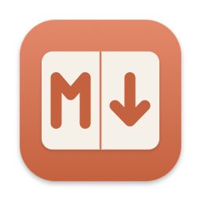
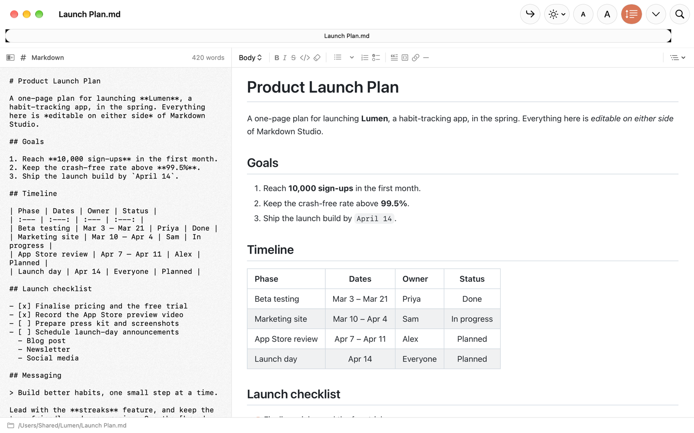
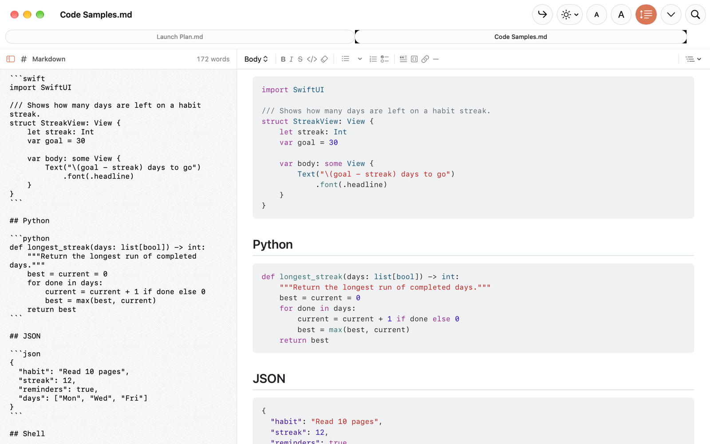
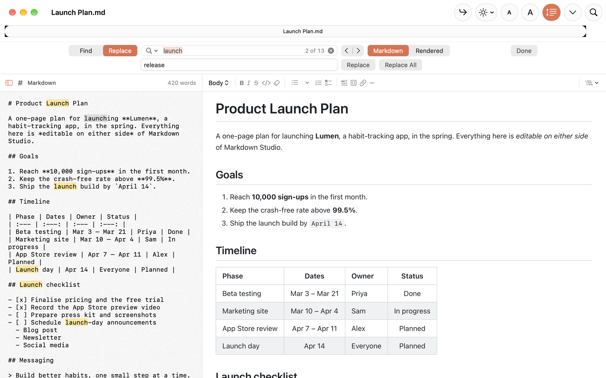
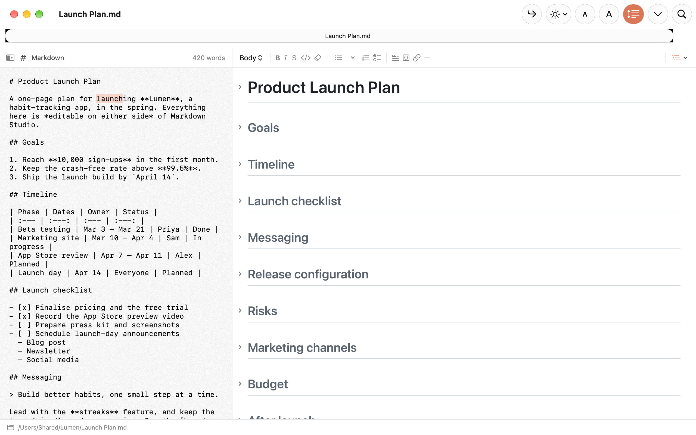
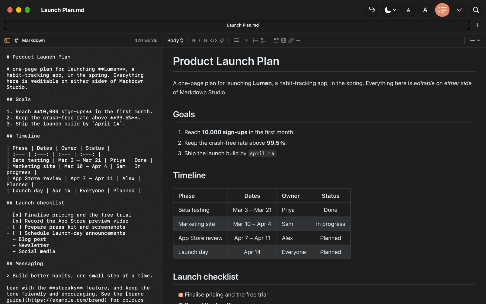
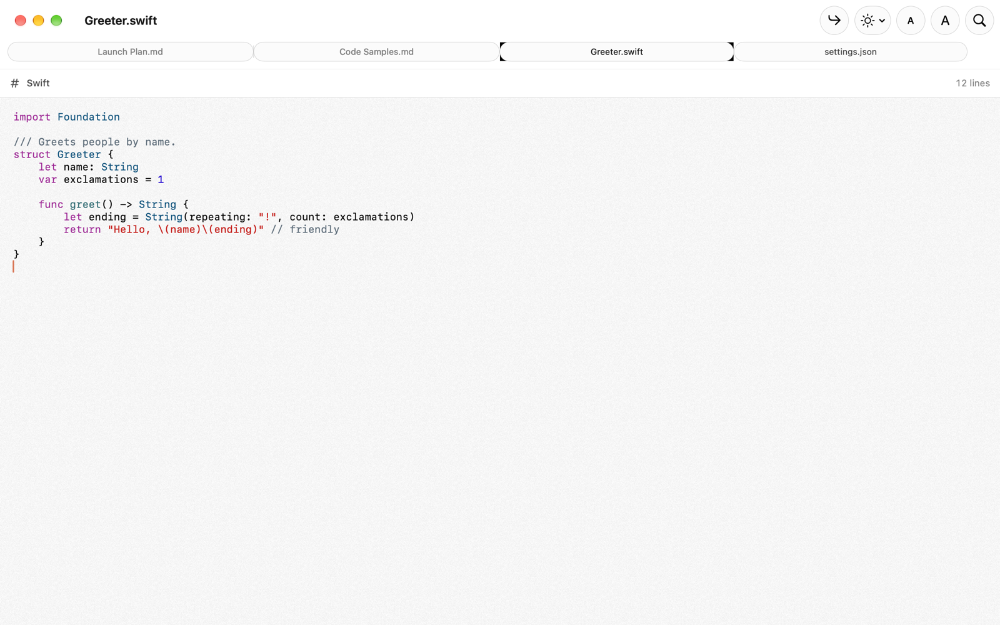

<p align="center">
  
</p>

<h1 align="center">Markdown Studio</h1>

<p align="center">
  A native Mac app for writing Markdown, with the source and the formatted document side by side — and both of them editable.
  It's also a quick, coloured editor for plain text, source code and config files.
</p>



## What's new

**1.4** — November 2026
- **Status bar** with the document's full path (View ▸ Show Status Bar, ⌘/). The **Revert** menu now lives at its right end, shown once the document has changed.
- The Show/Hide Markdown Pane button points the way the pane will go, and is orange only while the pane is hidden.

**1.3** — November 2026
- **Text and code files.** Open `.txt`, `.swift`, `.py`, `.json`, `.zshrc` and other text files for quick editing, like a Mac-native alternative to `nano` or `vim`. They get a single source pane, coloured in Xcode's colours and headed with the file's format ("Swift", "JSON", "Python"…), and are saved back exactly as they were.
- Open any text file from Terminal with `open -a MarkdownStudio <file>`.
- **Images next to the document** (relative paths like `docs/images/photo.png`) are shown in the rendered pane, after you allow access to their folder once.
- **Revert** from the toolbar (shown once the document has changed) or File ▸ Revert to Last Opened (⌥⌘Z): back to how the document was when opened in that tab, to the last save, or to any earlier version.
- The tab bar's **+** button asks whether to create a new document or open existing ones.
- Markdown documents open with the rendered pane taking two thirds of the window.
- A new path icon for Show File Path, and the Show/Hide Markdown Pane button in the accent colour.
- **Help ▸ Version History** shows what changed in each release.
- Fixed: the tab bar setting is remembered again, showing the Markdown pane again no longer jumps back to the top of the document, and typing or undoing in the rendered pane no longer makes it jump.

**1.2** — November 2026
- **Hideable Markdown pane.** Hide the source to see only the formatted document, with the button in the pane's header, View ▸ Show or Hide Markdown Pane, or ⌃⌘M. Each tab keeps its own layout.
- The Markdown pane has a soft, paper-textured light gray background.

**1.1** — October 2026
- **Syntax colouring** for fenced code blocks in the rendered pane.

## Features

- **Two editable panes.** Type Markdown on the left, or edit the formatted document on the right like a word processor. Each side updates the other as you type. Documents open with the rendered pane taking two thirds of the window.
- **Formatting toolbar.** Text styles (Body, Title 1–6, Code Block), bold, italic, strikethrough, inline code, bulleted lists with bullet styles, numbered lists, checklists, block quotes, links and horizontal rules.
- **Copy and paste that understands Markdown.** Copy from the rendered pane and get Markdown as plain text, plus rich text for other apps. Paste plain-text Markdown into the rendered pane and it's formatted.
- **Text and code files too.** Open any text file, such as `.txt`, `.swift`, `.py`, `.json` or `.zshrc`, for quick editing: it gets a single coloured source pane headed with its format, and is saved back exactly as it was.
- **Syntax colouring.** Fenced code blocks with a language name are coloured in the rendered pane in Xcode's colours: Swift, Python, JavaScript/TypeScript, JSON, shell, HTML, CSS, C/C++/Objective-C, Java, Kotlin, C#, Go, Rust, Ruby, SQL, YAML and diffs.
- **Find & Replace.** Search either pane, with match case, whole word / starts with / ends with, wrap around, and regular expressions with `$1`-style replacements.
- **Linked scrolling.** Keep both panes aligned as you scroll, line for line, even inside long lists and tables, or scroll them independently.
- **Collapsible sections and outline view.** Fold any section from its title, or show only Titles 1–N to see the document's outline.
- **Zoom, Dark Mode and file paths.** Scale the text in both panes, choose light, dark or system appearance, and see where each file lives in the window title, tabs and status bar.
- **Hideable Markdown pane.** Hide the source to see only the formatted document, separately in each tab. The Markdown pane has a soft, paper-textured background.
- **Revert and version history.** Go back to the document as it was when opened in each tab, to the last save, or browse every earlier version.
- **Tabs or windows.** Choose whether opened files go in a new tab, a new window, or ask each time. The tab bar's **+** button offers a new document or opening existing ones.
- **Built-in guide.** Help ▸ Markdown Studio Guide covers every feature, with a complete Markdown syntax reference.

Supported Markdown includes CommonMark plus GitHub-Flavored Markdown tables, strikethrough, task lists and automatic links. Embedded HTML blocks are rendered and preserved exactly as written.

## Screenshots

**Syntax colouring**



| Find & Replace | Outline view |
| --- | --- |
|  |  |

**Dark Mode**



**Text and code files**



## Requirements

- macOS 15 or later
- To build: Xcode 26 or later (Swift 6)

## Building and installing

Open `MarkdownStudio.xcodeproj` in Xcode and run the **MarkdownStudio** scheme.

Or build an optimised Release copy and install it in `/Applications` from the command line:

```bash
./install.sh
```

The script builds into `build/`, quits the app if it's running, replaces `/Applications/MarkdownStudio.app` and registers it with macOS so Finder and Spotlight pick up the new copy. Run it again after making changes.

> The app is signed to run locally ("Sign to Run Locally"). To share a build with others without macOS security warnings, sign it with a Developer ID certificate and notarize it.

## Keyboard shortcuts

| Action | Shortcut |
| --- | --- |
| Bold / Italic / Strikethrough | ⌘B / ⌘I / ⇧⌘X |
| Inline code / Link | ⌥⌘C / ⌘K |
| Body text / Title 1–6 | ⌥⌘0 / ⌥⌘1–⌥⌘6 |
| Bulleted / Numbered list / Checklist | ⇧⌘7 / ⇧⌘9 / ⇧⌘L |
| Block quote | ⌘' |
| Show or hide Find / Find and Replace | ⌘F / ⌥⌘F |
| Find next / previous | ⌘G / ⇧⌘G |
| Zoom in / out / actual size | ⌘+ / ⌘− / ⌘0 |
| Show everything / titles 1–N | ⌃⌘0 / ⌃⌘1–⌃⌘6 |
| Link or unlink scrolling | ⌥⌘L |
| Show or hide the Markdown pane | ⌃⌘M |
| Show or hide the status bar | ⌘/ |
| Open in new tab | ⌥⌘O |
| Revert to last opened | ⌥⌘Z |
| Markdown Studio Guide | ⌘? |

## How it works

The left pane is an `NSTextView` holding the Markdown source, which is the document that's saved. The right pane is a `WKWebView` running a small, dependency-free Markdown engine (`Editor/markdown.js`) that converts Markdown to HTML for display and converts the edited HTML back to Markdown. Every rendered block records the source line it came from, which is what keeps linked scrolling aligned.

Files that aren't Markdown open with only the source pane. `DocumentFormat` recognises the format from the file's extension or name, and `SyntaxHighlighter` colours it by running the same `syntax.js` tokenizer in Apple's built-in JavaScriptCore. The text itself is never changed, so files are saved exactly as they were.

```
MarkdownStudio/
├── MarkdownStudioApp.swift      App entry, document group, menus
├── ContentView.swift            Window layout and title-bar controls
├── SourceEditorView.swift       Source pane (NSTextView)
├── DocumentFormat.swift         Markdown, or which kind of text/code file
├── SyntaxHighlighter.swift      Colours code files with syntax.js via JavaScriptCore
├── RenderedEditorView.swift     Rendered pane (WKWebView)
├── DocumentRevert.swift         Revert to last opened / last saved, per tab
├── LocalImages.swift            Images next to the document (folder access, file loading)
├── Editor/                      editor.html, editor.js, markdown.js, syntax.js
├── FormattingToolbar.swift      Toolbar above the rendered pane
├── FindController.swift, FindBar.swift
├── ScrollSync.swift             Linked scrolling
├── Guide/                       In-app Help guide
└── …
docs/                            README screenshots and Demo.md
Design/                          App icon sources
```

Try it with [`docs/Demo.md`](docs/Demo.md) and [`docs/Code Samples.md`](docs/Code%20Samples.md).

To edit any text file from Terminal, use `open -a MarkdownStudio <file>`, for example `open -a MarkdownStudio ~/.zshrc`.
