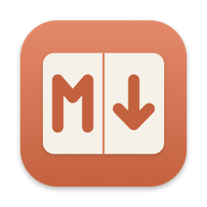
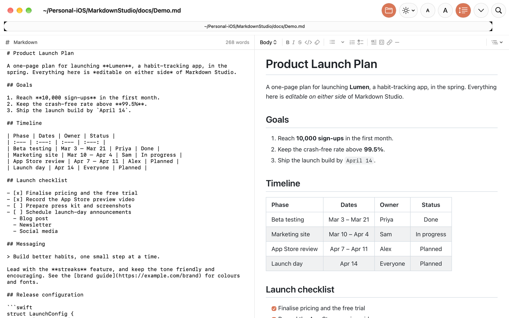
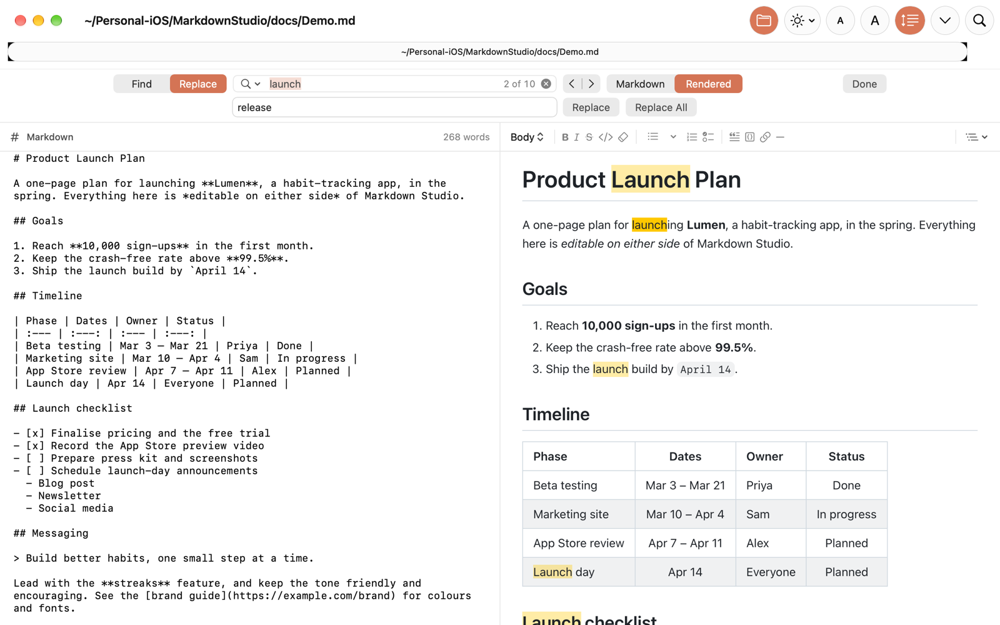
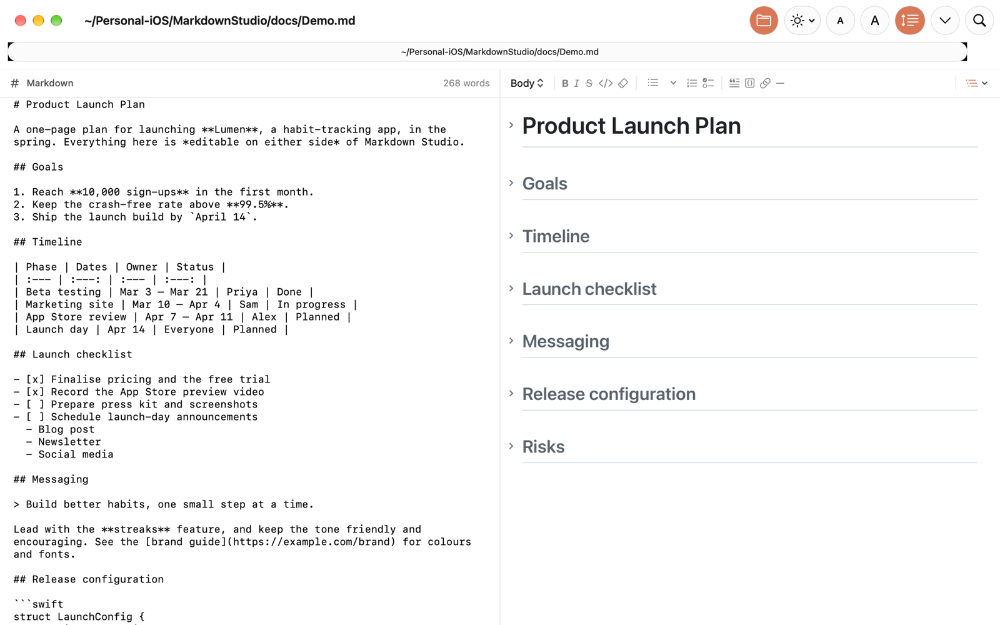
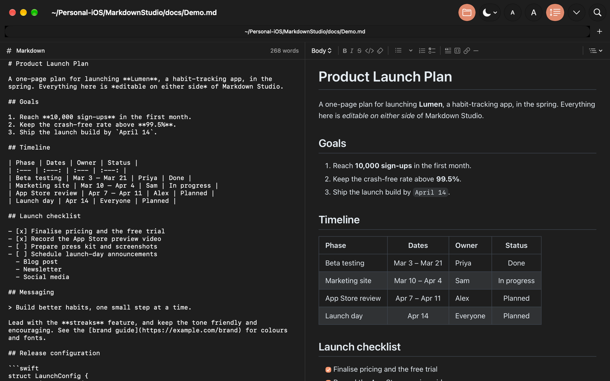

<p align="center">
  
</p>

<h1 align="center">Markdown Studio</h1>

<p align="center">
  A native Mac app for writing Markdown, with the source and the formatted document side by side — and both of them editable.
</p>



## Features

- **Two editable panes.** Type Markdown on the left, or edit the formatted document on the right like a word processor. Each side updates the other as you type.
- **Formatting toolbar.** Text styles (Body, Title 1–6, Code Block), bold, italic, strikethrough, inline code, bulleted lists with bullet styles, numbered lists, checklists, block quotes, links and horizontal rules.
- **Copy and paste that understands Markdown.** Copy from the rendered pane and get Markdown as plain text, plus rich text for other apps. Paste plain-text Markdown into the rendered pane and it's formatted.
- **Syntax colouring.** Fenced code blocks with a language name are coloured in the rendered pane in Xcode's colours: Swift, Python, JavaScript/TypeScript, JSON, shell, HTML, CSS, C/C++/Objective-C, Java, Kotlin, C#, Go, Rust, Ruby, SQL, YAML and diffs.
- **Find & Replace.** Search either pane, with match case, whole word / starts with / ends with, wrap around, and regular expressions with `$1`-style replacements.
- **Linked scrolling.** Keep both panes aligned as you scroll, line for line, even inside long lists and tables, or scroll them independently.
- **Collapsible sections and outline view.** Fold any section from its title, or show only Titles 1–N to see the document's outline.
- **Zoom, Dark Mode and file-path titles.** Scale the text in both panes, choose light, dark or system appearance, and see where each file lives in the window title and tabs.
- **Tabs or windows.** Choose whether opened files go in a new tab, a new window, or ask each time.
- **Built-in guide.** Help ▸ Markdown Studio Guide covers every feature, with a complete Markdown syntax reference.

Supported Markdown includes CommonMark plus GitHub-Flavored Markdown tables, strikethrough, task lists and automatic links. Embedded HTML blocks are rendered and preserved exactly as written.

## Screenshots

| Find & Replace | Outline view |
| --- | --- |
|  |  |

**Dark Mode**



## Requirements

- macOS 15 or later
- To build: Xcode 26 or later (Swift 6)

## Building and installing

Open `MarkdownStudio.xcodeproj` in Xcode and run the **MarkdownStudio** scheme.

Or build an optimised Release copy and install it in `/Applications` from the command line:

```bash
./install.sh
```

The script builds into `build/`, quits the app if it's running, replaces `/Applications/MarkdownStudio.app` and registers it with macOS so Finder and Spotlight pick up the new copy. Run it again after making changes.

> The app is signed to run locally ("Sign to Run Locally"). To share a build with others without macOS security warnings, sign it with a Developer ID certificate and notarize it.

## Keyboard shortcuts

| Action | Shortcut |
| --- | --- |
| Bold / Italic / Strikethrough | ⌘B / ⌘I / ⇧⌘X |
| Inline code / Link | ⌥⌘C / ⌘K |
| Body text / Title 1–6 | ⌥⌘0 / ⌥⌘1–⌥⌘6 |
| Bulleted / Numbered list / Checklist | ⇧⌘7 / ⇧⌘9 / ⇧⌘L |
| Block quote | ⌘' |
| Show or hide Find / Find and Replace | ⌘F / ⌥⌘F |
| Find next / previous | ⌘G / ⇧⌘G |
| Zoom in / out / actual size | ⌘+ / ⌘− / ⌘0 |
| Show everything / titles 1–N | ⌃⌘0 / ⌃⌘1–⌃⌘6 |
| Link or unlink scrolling | ⌥⌘L |
| Open in new tab | ⌥⌘O |
| Markdown Studio Guide | ⌘? |

## How it works

The left pane is an `NSTextView` holding the Markdown source, which is the document that's saved. The right pane is a `WKWebView` running a small, dependency-free Markdown engine (`Editor/markdown.js`) that converts Markdown to HTML for display and converts the edited HTML back to Markdown. Every rendered block records the source line it came from, which is what keeps linked scrolling aligned.

```
MarkdownStudio/
├── MarkdownStudioApp.swift      App entry, document group, menus
├── ContentView.swift            Window layout and title-bar controls
├── SourceEditorView.swift       Markdown pane (NSTextView)
├── RenderedEditorView.swift     Rendered pane (WKWebView)
├── Editor/                      editor.html, editor.js, markdown.js, syntax.js
├── FormattingToolbar.swift      Toolbar above the rendered pane
├── FindController.swift, FindBar.swift
├── ScrollSync.swift             Linked scrolling
├── Guide/                       In-app Help guide
└── …
docs/                            README screenshots and Demo.md
Design/                          App icon sources
```

Try it with [`docs/Demo.md`](docs/Demo.md).
